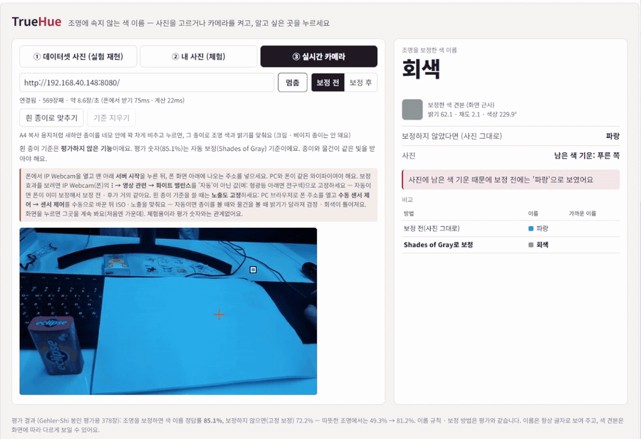
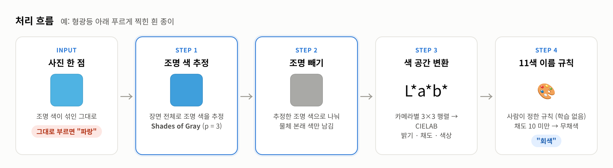
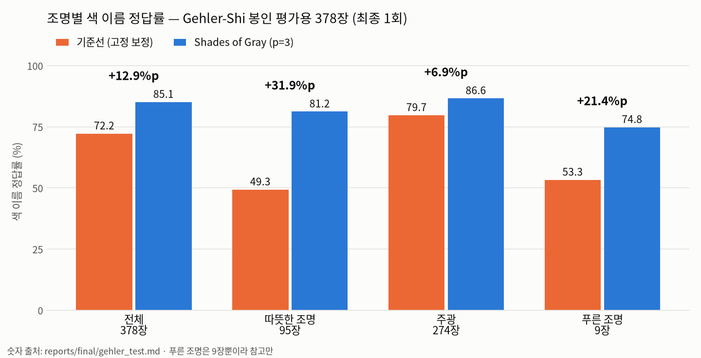

<p align="center">
  
</p>

<p align="center">
  <b>조명 색을 먼저 추정해 지운 뒤 색 이름을 붙이는 감별기</b><br>
  <sub>KH정보교육원 교과 9 머신비전 미니 프로젝트 · 1조 심준형 · 김하민 · 2026.10.27 ~</sub>
</p>

<p align="center">
  
  
  
  
  
</p>

<table align="center">
  <tr>
    <td align="center" width="230"><h2>72.2% → 85.1%</h2>색 이름 정답률<br><sub>+12.9%p · 봉인 평가 378장</sub></td>
    <td align="center" width="230"><h2>49.3% → 81.2%</h2>따뜻한 조명에서<br><sub>+31.9%p · 효과가 가장 큰 곳</sub></td>
    <td align="center" width="230"><h2>1.68°</h2>조명 추정 오차<br><sub>SimpleCube++ 462장 중앙값</sub></td>
  </tr>
</table>

<p align="center">
  <br>
  <sub>폰 카메라 실시간 — 푸르게 찍힌 흰 종이: 보정 전 <b>파랑</b> → 자동 보정 <b>회색</b> → 흰 종이 기준 <b>흰색</b> · 빨간 통 <b>진한 빨강</b></sub>
</p>

## 무엇을 했나

| 단계 | 한 일 | 자세히 |
|---|---|---|
| 🎯 **문제** | 찍힌 픽셀 색을 그대로 이름으로 바꾸면 조명이 바뀔 때 이름도 바뀐다. 색각이상 사용자는 틀려도 알 수 없다 | [방법과 검증](docs/evaluation.md#문제) |
| 🔬 **방법** | 학습 없이 **조명 추정**(Gray World · White Patch · Shades of Gray) → 조명 빼기 → **사람이 정한 11색 규칙** | [방법](docs/evaluation.md#방법) |
| 📊 **검증** | 공개 데이터셋을 보정용/평가용으로 나누고, 채점 규칙을 먼저 고정한 뒤 **평가용은 단 한 번만** 채점 | [결과 리포트](reports/final/gehler_test.md) |
| 🖥️ **시제품** | FastAPI 웹 — 데이터셋 재현 · 내 사진 · **폰 실시간 카메라**, 틀릴 수 있을 땐 "판단하기 어려워요" | [웹 설명](docs/web.md) |

<p align="center"></p>

## 결과

<p align="center"></p>

| 방법 | 정답률 | 기준선 대비 |
|---|---|---|
| 기준선 (고정 보정) | 72.2% | — |
| Gray World | 79.9% | +7.7%p |
| White Patch | 66.6% | −5.5%p |
| **Shades of Gray (p=3)** | **85.1%** | **+12.9%p** [95% 구간 +10.7, +15.1] |
| 상한선 (정답 조명) | 95.4% | +23.3%p |

<sub>Gehler-Shi 평가용 378장 · 8,240칸, 최종 1회 (2026-10-30). 웹의 ② 내 사진 · ③ 실시간은 체험용이라 정답률을 따로 재지 않았다 · 한계: 실제 색각이상 사용자 시험 전, 약 일곱 번에 한 번 틀림 → [한계](docs/troubleshooting.md#아직-아닌-것-한계)</sub>

## 신경 쓴 점

| 포인트 | 내용 |
|---|---|
| 🔒 **숫자를 믿을 수 있게** | 평가용 사진은 끝까지 열지 않고, 채점 규칙을 미리 문서로 고정, 최종 실행은 코드 잠금으로 1회만 → [결정 기록](reports/decisions.md) |
| 👀 **사람이 직접 확인** | 컬러체커 568장을 눈으로 전수 검수 (자동 528 · 수정 40), 정답표 24칸도 근거를 적어 사람이 정함 |
| 🧪 **스스로 점검하는 코드** | 웹 계산 = 평가 계산 600/600 일치, 가짜 카메라로 49개 자동 점검 → [문제 해결 기록](docs/troubleshooting.md) |

## 폴더 구조

| 폴더 | 내용 |
|---|---|
| [`src/`](src) | 데이터 확인 → 분할 → 색 변환 → 조명 추정 → 채점 (00 ~ 22 순서) |
| [`app/`](app) | 웹 (FastAPI) — 계산 · 서버 · 화면 · 자기 점검 · 가짜 카메라 |
| [`reports/`](reports) | [결정 기록](reports/decisions.md) · [데이터 노트](reports/data_notes.md) · 정답표 · 설정값 |
| [`reports/final/`](reports/final) | 최종 1회 평가 결과 (봉인) |
| [`splits/`](splits) | 보정용 190장 / 평가용 378장 목록 |
| [`docs/`](docs) | README 그림 · 상세 문서 |
| `data/` · `outputs/` | 데이터셋 원본 · 실행 결과 (깃 제외) |

## 실행

```bash
pip install -r requirements.txt
uvicorn app.main:app --port 8000      # → http://localhost:8000
```

설치 · 데이터 받기 · 전체 실행 순서 → [docs/setup.md](docs/setup.md) · 개발 과정 → [docs/dev_log.md](docs/dev_log.md)

<sub>데이터: Gehler-Shi (Shi & Funt 재처리판) · SimpleCube++ (Ershov et al., CC BY 4.0) — 출처 전체는 [setup.md](docs/setup.md#데이터-출처)</sub>
