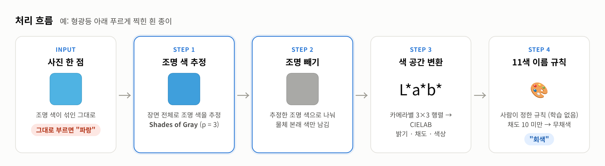
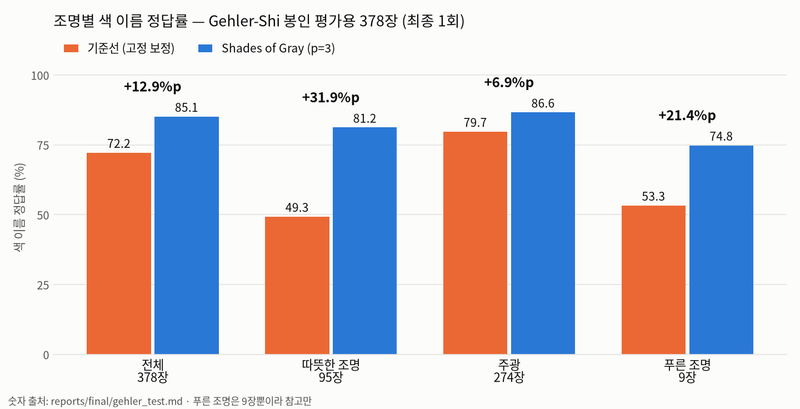

# 방법과 검증

[← README로 돌아가기](../README.md)

## 문제

카메라에 찍힌 픽셀 색을 그대로 이름으로 바꾸면, 조명이 바뀔 때 같은 물체도 다른 이름이 나온다.
따뜻한 실내 조명에서는 흰색 · 회색이 주황 쪽으로, 형광등 · 그늘에서는 파랑 쪽으로 밀린다.
사람 눈은 이 조명 색을 자동으로 빼고 보지만(색 항상성), 색 이름 앱은 그렇지 못하다.

**색각이상이 있는 사용자는 앱이 틀린 이름을 말해도 스스로 알아챌 수 없다.**
그래서 "조명이 바뀌어도 이름이 흔들리지 않는가"를 데이터로 확인할 수 있어야 한다.

- 목표: 조명 보정 단계를 하나 추가하고, **조명에 적응하지 않는 고정 보정(기준선)** 대비 정답률이 얼마나 오르는지 **숫자로** 보인다
- 기준선 정답률: 전체 72.2%, 따뜻한 조명(4,000K 미만)에서는 **49.3%** — 두 번에 한 번꼴로 틀린다

## 방법

- **조명 추정 3종**: Gray World(장면 평균은 회색) · White Patch(가장 밝은 곳은 흰색) · 그 사이인 **Shades of Gray**(p제곱 평균).
  p는 보정용 사진에서 각도 오차 중앙값이 가장 작은 값으로 골랐다 → 두 데이터셋 모두 **p = 3** (D11)
- **이름 규칙** (`src/namer.py`): 학습 없이 사람이 정한 규칙 — 채도 < 10이면 밝기로 검정 · 회색 · 흰색, 아니면 색상 각도 7구간 + 어두운 주황은 갈색.
  컬러체커 표준 색 24개로만 기준을 정했다 (24/24 정답)
- **공정한 비교**: 기준선 · 보정 3종 · 상한선(정답 조명을 그대로 쓴 경우)이 **조명 추정만 다르고** 색 변환 · 이름 규칙은 같다.
  사진 속 컬러체커는 답을 알려 주므로 조명을 추정할 때 가린다

## 검증 — 봉인 평가용 사진으로 단 한 번 채점

  

| 방법 | 정답률 [95% 구간] | 기준선 대비 [95% 구간] |
|---|---|---|
| 기준선 (조명에 적응하지 않는 고정 보정) | 72.2% [70.4, 73.9] | — |
| Gray World | 79.9% [78.2, 81.5] | +7.7%p [+5.3, +10.0] |
| White Patch | 66.6% [64.1, 69.3] | −5.5%p [−8.4, −2.5] |
| **Shades of Gray (p = 3)** | **85.1%** [83.5, 86.6] | **+12.9%p** [+10.7, +15.1] |
| 상한선 (정답 조명) | 95.4% [95.0, 95.9] | +23.3%p [+21.6, +24.9] |

- **조명이 평균(주광)에서 멀수록 효과가 크다**: 따뜻한 조명 95장 +31.9%p · 푸른 조명 9장 +21.4%p(장수가 적어 참고) · 주광 274장 +6.9%p
- Shades of Gray가 기준선과 상한선 사이 간격의 **55%**를 메운다. 정답 조명이 의심스러운 사진 2장을 빼도 +12.9%p로 같다 (D9)
- 보정용 사진의 채점 연습(86.0% vs 74.1%, +11.8%p)과 거의 같아, 보정용에만 맞춰진 결과가 아니다
- 보조 결과 — SimpleCube++ test 462장 조명 추정 각도 오차 중앙값: Shades of Gray **1.68°** · Gray World 2.21° · White Patch 2.60°

**숫자를 믿을 수 있게 한 장치**

| 장치 | 내용 |
|---|---|
| 분할 고정 | 보정용 1/3(190장)로만 행렬 · p · 기준선 조명을 정하고, 평가용 2/3(378장)는 마지막까지 열지 않음 (`splits/`) |
| 미리 정한 주 결과 | 채점 규칙 · 주 결과(전체 24칸 정답률 차이) · 보고 범위를 채점 **전에** 문서로 고정 (D10) |
| 한 번만 실행 | 리허설로 보정용 숫자를 그대로 재현한 뒤, `--final`은 커밋 안 된 변경이 있거나 이미 실행했으면 멈춤 (D12) |
| 오차 범위 | 사진 단위 부트스트랩 2,000회 · 95% 구간 · 같은 사진끼리 짝지어 방법 비교 |
| 정답표 | "가장 가까운 대표색" 자동 방식은 5칸이 틀려서, 24칸 이름을 사람이 근거를 적어 정함 (애매한 8칸은 두 이름 모두 정답, D2) |

전체 결과: [`reports/final/gehler_test.md`](../reports/final/gehler_test.md) · [`reports/final/simplecube_test.md`](../reports/final/simplecube_test.md)
